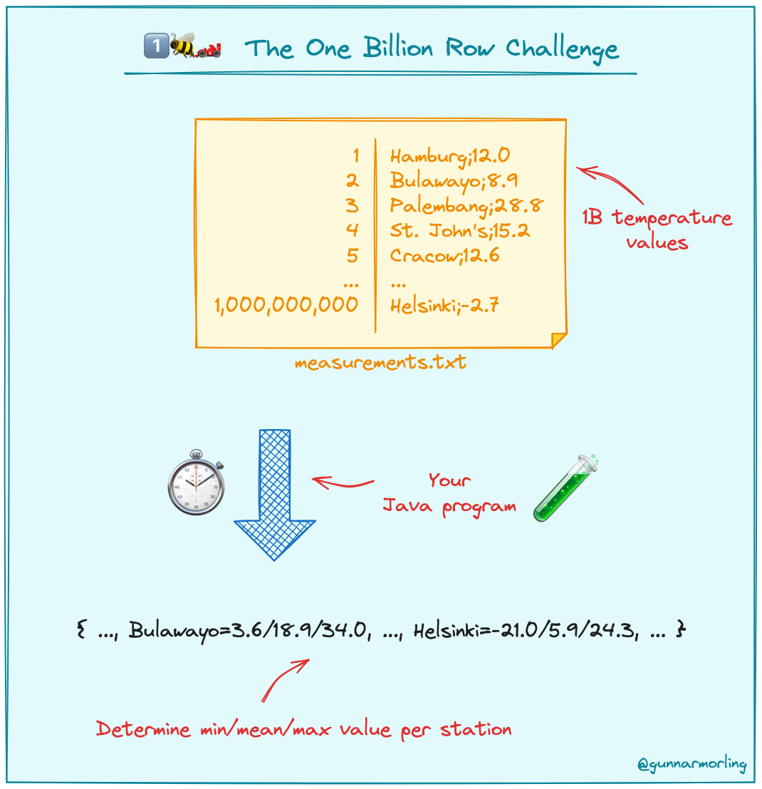

# 1️⃣🐝🏎️ The One Billion Row Challenge

The One Billion Row Challenge (1BRC) is a fun exploration of how far modern Java can be pushed for aggregating one billion rows from a text file.
Grab all your (virtual) threads, reach out to SIMD, optimize your GC, or pull any other trick, and create the fastest implementation for solving this task!



The text file contains temperature values for a range of weather stations.
Each row is one measurement in the format `<string: station name>;<double: measurement>`, with the measurement value having exactly one fractional digit.
The following shows ten rows as an example:

```
Hamburg;12.0
Bulawayo;8.9
Palembang;38.8
St. John's;15.2
Cracow;12.6
Bridgetown;26.9
Istanbul;6.2
Roseau;34.4
Conakry;31.2
Istanbul;23.0
```

The task is to write a Java program which reads the file, calculates the min, mean, and max temperature value per weather station, and emits the results on stdout like this
(i.e. sorted alphabetically by station name, and the result values per station in the format `<min>/<mean>/<max>`, rounded to one fractional digit):

```
{Abha=-23.0/18.0/59.2, Abidjan=-16.2/26.0/67.3, Abéché=-10.0/29.4/69.0, Accra=-10.1/26.4/66.4, Addis Ababa=-23.7/16.0/67.0, Adelaide=-27.8/17.3/58.5, ...}
```

Submit your implementation by Jan 31 2024 and become part of the leaderboard!

## Prerequisites

[Java 21](https://openjdk.org/projects/jdk/21/) must be installed on your system.

## Running the Challenge

This repository contains two programs:

* `dev.morling.onebrc.CreateMeasurements` (invoked via _create\_measurements.sh_): Creates the file _measurements.txt_ in the root directory of this project with a configurable number of random measurement values
* `dev.morling.onebrc.CalculateAverage` (invoked via _calculate\_average\_baseline.sh_): Calculates the average values for the file _measurements.txt_

Execute the following steps to run the challenge:

1. Build the project using Apache Maven:

    ```
    ./mvnw clean verify
    ```

2. Create the measurements file with 1B rows (just once):

    ```
    ./create_measurements.sh 1000000000
    ```

    This will take a few minutes.
    **Attention:** the generated file has a size of approx. **12 GB**, so make sure to have enough diskspace.

    If you're running the challenge with a non-Java language, there's a non-authoritative Python script to generate the measurements file at `src/main/python/create_measurements.py`. The authoritative method for generating the measurements is the Java program `dev.morling.onebrc.CreateMeasurements`.

3. Calculate the average measurement values:

    ```
    ./calculate_average_baseline.sh
    ```

    The provided naive example implementation uses the Java streams API for processing the file and completes the task in ~2 min on environment used for [result evaluation](#evaluating-results).
    It serves as the base line for comparing your own implementation.

4. Optimize the heck out of it:

    Adjust the `CalculateAverage` program to speed it up, in any way you see fit (just sticking to a few rules described below).
    Options include parallelizing the computation, using the (incubating) Vector API, memory-mapping different sections of the file concurrently, using AppCDS, GraalVM, CRaC, etc. for speeding up the application start-up, choosing and tuning the garbage collector, and much more.

## Flamegraph/Profiling

A tip is that if you have [jbang](https://jbang.dev) installed, you can get a flamegraph of your program by running
[async-profiler](https://github.com/jvm-profiling-tools/async-profiler) via [ap-loader](https://github.com/jvm-profiling-tools/ap-loader):

`jbang --javaagent=ap-loader@jvm-profiling-tools/ap-loader=start,event=cpu,file=profile.html -m dev.morling.onebrc.CalculateAverage_yourname target/average-1.0.0-SNAPSHOT.jar`

or directly on the .java file:

`jbang --javaagent=ap-loader@jvm-profiling-tools/ap-loader=start,event=cpu,file=profile.html src/main/java/dev/morling/onebrc/CalculateAverage_yourname`

When you run this, it will generate a flamegraph in profile.html. You can then open this in a browser and see where your program is spending its time.

## Rules and limits

* Any of these Java distributions may be used:
    * Any builds provided by [SDKMan](https://sdkman.io/jdks)
    * Early access builds available on openjdk.net may be used (including EA builds for OpenJDK projects like Valhalla)
    * Builds on [builds.shipilev.net](https://builds.shipilev.net/openjdk-jdk-lilliput/)
If you want to use a build not available via these channels, reach out to discuss whether it can be considered.
* No external library dependencies may be used
* Implementations must be provided as a single source file
* The computation must happen at application _runtime_, i.e. you cannot process the measurements file at _build time_
(for instance, when using GraalVM) and just bake the result into the binary
* Input value ranges are as follows:
    * Station name: non null UTF-8 string of min length 1 character and max length 100 bytes, containing neither `;` nor `\n` characters. (i.e. this could be 100 one-byte characters, or 50 two-byte characters, etc.)
    * Temperature value: non null double between -99.9 (inclusive) and 99.9 (inclusive), always with one fractional digit
* There is a maximum of 10,000 unique station names
* Line endings in the file are `\n` characters on all platforms
* Implementations must not rely on specifics of a given data set, e.g. any valid station name as per the constraints above and any data distribution (number of measurements per station) must be supported
* The rounding of output values must be done using the semantics of IEEE 754 rounding-direction "roundTowardPositive"

## Entering the Challenge

To submit your own implementation to 1BRC, follow these steps:

* Create a fork of the [onebrc](https://github.com/gunnarmorling/onebrc/) GitHub repository.
* Run `./create_fork.sh <your_GH_user>` to copy the baseline implementation to your personal files, or do this manually:
  * Create a copy of _CalculateAverage\_baseline.java_, named _CalculateAverage\_<your_GH_user>.java_, e.g. _CalculateAverage\_doloreswilson.java_.
  * Create a copy of _calculate\_average\_baseline.sh_, named _calculate\_average\_<your_GH_user>.sh_, e.g. _calculate\_average\_doloreswilson.sh_.
  * Adjust that script so that it references your implementation class name. If needed, provide any JVM arguments via the `JAVA_OPTS` variable in that script.
    Make sure that script does not write anything to standard output other than calculation results.
  * (Optional) OpenJDK 21 is used by default. If a custom JDK build is required, create a copy of _prepare\_baseline.sh_, named _prepare\_<your_GH_user>.sh_, e.g. _prepare\_doloreswilson.sh_. Include the SDKMAN command `sdk use java [version]` in the your prepare script.
  * (Optional) If you'd like to use native binaries (GraalVM), add all the required build logic to your _prepare\_<your_GH_user>.sh_ script.
* Make that implementation fast. Really fast.
* Run the test suite by executing _/test.sh <your_GH_user>_; if any differences are reported, fix them before submitting your implementation.
* Create a pull request against the upstream repository, clearly stating
  * The name of your implementation class.
  * The execution time of the program on your system and specs of the same (CPU, number of cores, RAM). This is for informative purposes only, the official runtime will be determined as described below.
* I will run the program and determine its performance as described in the next section, and enter the result to the scoreboard.

**Note:** I reserve the right to not evaluate specific submissions if I feel doubtful about the implementation (I.e. I won't run your Bitcoin miner ;).

If you'd like to discuss any potential ideas for implementing 1BRC with the community,
you can use the [GitHub Discussions](https://github.com/gunnarmorling/onebrc/discussions) of this repository.
Please keep it friendly and civil.

The challenge runs until Jan 31 2024.
Any submissions (i.e. pull requests) created after Jan 31 2024 23:59 UTC will not be considered.

## Evaluating Results

Results are determined by running the program on a [Hetzner AX161](https://www.hetzner.com/dedicated-rootserver/ax161) dedicated server (32 core AMD EPYC™ 7502P (Zen2), 128 GB RAM).

Programs are run from  a RAM disk (i.o. the IO overhead for loading the file from disk is not relevant), using 8 cores of the machine.
Each contender must pass the 1BRC test suite (_/test.sh_).
The `hyperfine` program is used for measuring execution times of the launch scripts of all entries, i.e. end-to-end times are measured.
Each contender is run five times in a row.
The slowest and the fastest runs are discarded.
The mean value of the remaining three runs is the result for that contender and will be added to the results table above.
The exact same _measurements.txt_ file is used for evaluating all contenders.
See the script _evaluate.sh_ for the exact implementation of the evaluation steps.

## Prize

If you enter this challenge, you may learn something new, get to inspire others, and take pride in seeing your name listed in the scoreboard above.
Rumor has it that the winner may receive a unique 1️⃣🐝🏎️ t-shirt, too!

## FAQ

_Q: Can I use Kotlin or other JVM languages other than Java?_\
A: No, this challenge is focussed on Java only. Feel free to inofficially share implementations significantly outperforming any listed results, though.

_Q: Can I use non-JVM languages and/or tools?_\
A: No, this challenge is focussed on Java only. Feel free to inofficially share interesting implementations and results though. For instance it would be interesting to see how DuckDB fares with this task.

_Q: I've got an implementation—but it's not in Java. Can I share it somewhere?_\
A: Whilst non-Java solutions cannot be formally submitted to the challenge, you are welcome to share them over in the [Show and tell](https://github.com/gunnarmorling/1brc/discussions/categories/show-and-tell) GitHub discussion area.

_Q: Can I use JNI?_\
A: Submissions must be completely implemented in Java, i.e. you cannot write JNI glue code in C/C++. You could use AOT compilation of Java code via GraalVM though, either by AOT-compiling the entire application, or by creating a native library (see [here](https://www.graalvm.org/22.0/reference-manual/native-image/ImplementingNativeMethodsInJavaWithSVM/).

_Q: What is the encoding of the measurements.txt file?_\
A: The file is encoded with UTF-8.

_Q: Can I make assumptions on the names of the weather stations showing up in the data set?_\
A: No, while only a fixed set of station names is used by the data set generator, any solution should work with arbitrary UTF-8 station names
(for the sake of simplicity, names are guaranteed to contain no `;` or `\n` characters).

_Q: Can I copy code from other submissions?_\
A: Yes, you can. The primary focus of the challenge is about learning something new, rather than "winning". When you do so, please give credit to the relevant source submissions. Please don't re-submit other entries with no or only trivial improvements.

_Q: Which operating system is used for evaluation?_\
A: Fedora 39.

_Q: My solution runs in 2 sec on my machine. Am I the fastest 1BRC-er in the world?_\
A: Probably not :) 1BRC results are reported in wallclock time, thus results of different implementations are only comparable when obtained on the same machine. If for instance an implementation is faster on a 32 core workstation than on the 8 core evaluation instance, this doesn't allow for any conclusions. When sharing 1BRC results, you should also always share the result of running the baseline implementation on the same hardware.

_Q: Why_ 1️⃣🐝🏎️ _?_\
A: It's the abbreviation of the project name: **One** **B**illion **R**ow **C**hallenge.

## 1BRC on the Web

A list of external resources such as blog posts and videos, discussing 1BRC and specific implementations:

* [The One Billion Row Challenge Shows That Java Can Process a One Billion Rows File in Two Seconds ](https://www.infoq.com/news/2024/01/1brc-fast-java-processing), by Olimpiu Pop (interview)
* [Cliff Click discussing his 1BRC solution on the Coffee Compiler Club](https://www.youtube.com/watch?v=NJNIbgV6j-Y) (video)
* [1️⃣🐝🏎️🦆 (1BRC in SQL with DuckDB)](https://rmoff.net/2024/01/03/1%EF%B8%8F%E2%83%A3%EF%B8%8F-1brc-in-sql-with-duckdb/), by Robin Moffatt (blog post)
* [1 billion rows challenge in PostgreSQL and ClickHouse](https://ftisiot.net/posts/1brows/), by Francesco Tisiot (blog post)
* [The One Billion Row Challenge with Snowflake](https://medium.com/snowflake/the-one-billion-row-challenge-with-snowflake-f612ae76dbd5), by Sean Falconer (blog post)
* [One billion row challenge using base R](https://www.r-bloggers.com/2024/01/one-billion-row-challenge-using-base-r/), by  David Schoch (blog post)
* [1 Billion Row Challenge with Apache Pinot](https://hubertdulay.substack.com/p/1-billion-row-challenge-in-apache), by Hubert Dulay (blog post)
* [One Billion Row Challenge In C](https://www.dannyvankooten.com/blog/2024/1brc/), by Danny Van Kooten (blog post)
* [One Billion Row Challenge in Racket](https://defn.io/2024/01/10/one-billion-row-challenge-in-racket/), by Bogdan Popa (blog post)
* [The One Billion Row Challenge - .NET Edition](https://dev.to/mergeconflict/392-the-one-billion-row-challenge-net-edition), by Frank A. Krueger (podcast)
* [One Billion Row Challenge](https://curiouscoding.nl/posts/1brc/), by Ragnar Groot Koerkamp (blog post)
* [ClickHouse and The One Billion Row Challenge](https://clickhouse.com/blog/clickhouse-one-billion-row-challenge), by Dale McDiarmid (blog post)
* [One Billion Row Challenge & Azure Data Explorer](https://nielsberglund.com/post/2024-01-28-one-billion-row-challenge--azure-data-explorer/), by Niels Berglund (blog post)
* [One Billion Row Challenge - view from sidelines](https://www.chashnikov.dev/post/one-billion-row-challenge-view-from-sidelines), by Leo Chashnikov (blog post)
* [1 billion row challenge in SQL and Oracle Database](https://geraldonit.com/2024/01/31/1-billion-row-challenge-in-sql-and-oracle-database/), by Gerald Venzl (blog post)
* [One Billion Row Challenge: Learned So Far](https://gamlor.info/posts-output/2024-01-12-one-billion-row-challenge/en/), by Roman Stoffel (blog post)
* [One Billion Row Challenge in Racket](https://defn.io/2024/01/10/one-billion-row-challenge-in-racket/), by Bogdan Popa (blog post)
* [The 1 Billion row challenge with Singlestore](https://medium.com/@testily/the-1-billion-row-challenge-with-singlestore-224ce97e451f), by Anna Semjen (blog post)
* [1BRC in .NET among fastest on Linux: My Optimization Journey](https://hotforknowledge.com/2024/01/13/1brc-in-dotnet-among-fastest-on-linux-my-optimization-journey/), by Victor Baybekov (blog post)
* [One Billion Rows – Gerald’s Challenge](https://connor-mcdonald.com/2024/02/03/one-billion-rows-geralds-challenge/), by Connor McDonald (blog post)
* [Reading a file insanely fast in Java](https://rmannibucau.metawerx.net/reading-a-file-insanely-fast-in-java.html), by Romain Manni-Bucau (blog post)
* [#1BRC Timeline](https://tivrfoa.github.io/java/benchmark/performance/2024/02/05/1BRC-Timeline.html), by tivrfoa (blog post)
* [1BRC - What a Journey](https://www.esolutions.tech/1brc-what-a-journey), by Marius Staicu (blog post)
* [One Billion Rows Challenge in Golang](https://www.bytesizego.com/blog/one-billion-row-challenge-go), by Shraddha Agrawal (blog post)
* [The Billion Row Challenge (1BRC) - Step-by-step from 71s to 1.7s](https://questdb.io/blog/billion-row-challenge-step-by-step/) by Marko Topolnik (blog post)
* [Entering The One Billion Row Challenge With GitHub Copilot](https://devblogs.microsoft.com/java/entering-the-one-billion-row-challenge-with-github-copilot/) by Antonio Goncalves (blog post)
* [DataFrame and The One Billion Row Challenge--How to use a Java DataFrame to save developer time, produce readable code, and not win any prizes](https://medium.com/@zakhav/dataframe-and-one-billion-row-challenge-97b3d0255dd1) by Vladimir Zakharov (blog post)
## License

This code base is available under the Apache License, version 2.

## Code of Conduct

Be excellent to each other!
More than winning, the purpose of this challenge is to have fun and learn something new.
